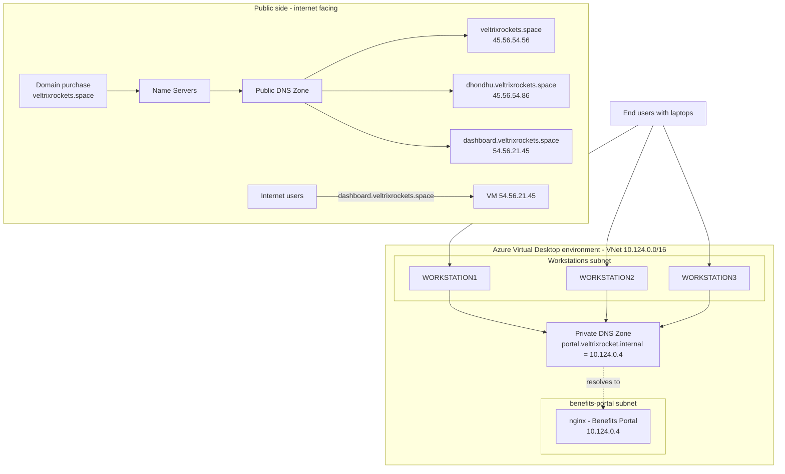
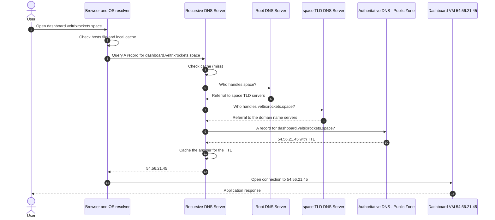
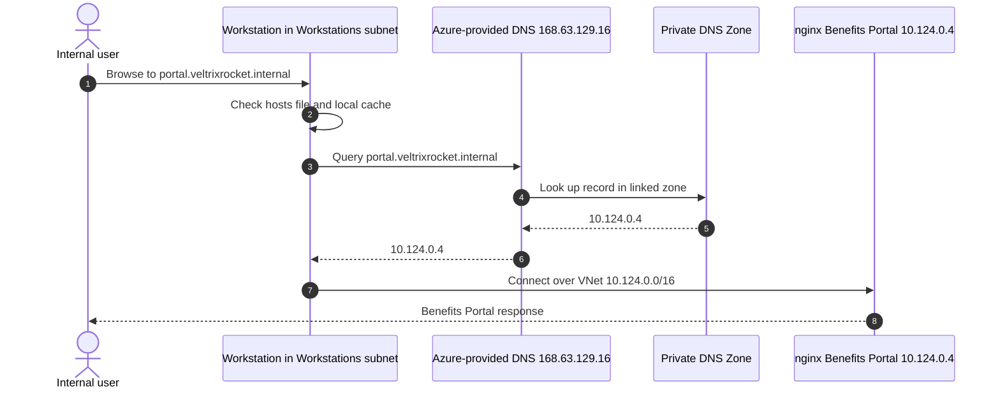
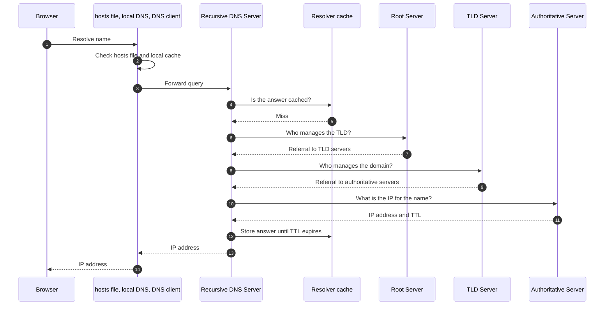
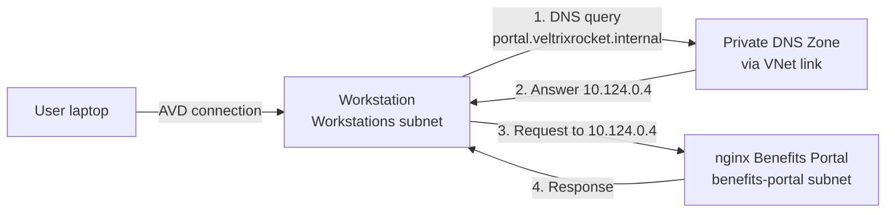

# DNS-Based Application Access on Azure: Public DNS, Private DNS, and Azure Virtual Desktop

> Architecture documentation for a DNS-driven access design that combines an internet-facing public DNS zone, an Azure Private DNS zone for an internal Benefits Portal, Azure Virtual Desktop workstations, and an end-to-end walkthrough of recursive DNS resolution.

> **Scope note:** This repository documents an architecture design based on a diagram. It does not include deployment evidence, monitoring data, or production claims. Anything not visible in the diagram is explicitly labelled as an **Assumption** or a **Recommended implementation**.

---

## Table of Contents

1. [Project Overview](#1-project-overview)
2. [Project Objectives](#2-project-objectives)
3. [Architecture Diagram](#3-architecture-diagram)
4. [Architecture Components Explained](#4-architecture-components-explained)
5. [Public DNS Resolution Flow](#5-public-dns-resolution-flow)
6. [Private DNS Resolution Flow](#6-private-dns-resolution-flow)
7. [Recursive DNS Resolution Explained](#7-recursive-dns-resolution-explained)
8. [Azure Network Architecture](#8-azure-network-architecture)
9. [Benefits Portal Access Flow](#9-benefits-portal-access-flow)
10. [DNS Caching and Troubleshooting](#10-dns-caching-and-troubleshooting)
11. [Network and DNS Security Considerations](#11-network-and-dns-security-considerations)
12. [Technologies and Services Used](#12-technologies-and-services-used)
13. [Key Technical Learnings](#13-key-technical-learnings)
14. [Future Improvements](#14-future-improvements)
15. [Diagram Notes and Assumptions](#15-diagram-notes-and-assumptions)

---

## 1. Project Overview

Name resolution is the first dependency of almost every application connection, and it is often misunderstood because it happens invisibly. This project documents a design that makes DNS the access mechanism for two different audiences:

| Audience | Application | Name | DNS type |
|---|---|---|---|
| Internet users | Public dashboard | `dashboard.veltrixrockets.space` | Public DNS zone |
| Internal users (via Azure Virtual Desktop) | Benefits Portal (nginx) | `portal.veltrixrocket.internal` | Azure Private DNS zone |

The design has three parts:

1. **Public DNS.** A purchased domain (`veltrixrockets.space`) delegated to name servers that host a public zone with A-style records mapping hostnames to public IP addresses.
2. **Private DNS.** An Azure Private DNS zone linked to the virtual network `10.124.0.0/16`, resolving `portal.veltrixrocket.internal` to the private address `10.124.0.4`, which is never exposed to the internet.
3. **Recursive resolution.** A step-by-step explanation of how a client name lookup travels from the browser through the hosts file, local resolver, recursive DNS server, root, TLD, and authoritative servers.

---

## 2. Project Objectives

- Show how a registered domain is delegated and published through a **public DNS zone**.
- Show how an internet user reaches a public application by hostname.
- Show how **internal-only** names are resolved with **Azure Private DNS** so the Benefits Portal stays off the public internet.
- Clearly separate **public** and **private** DNS responsibilities (split-purpose namespaces).
- Explain the full **recursive resolution chain** (root, TLD, authoritative) and the role of caching.
- Provide a practical **troubleshooting toolkit** for Linux and Windows.
- Capture **security considerations** relevant to DNS and the Azure network layout.

---

## 3. Architecture Diagram


> Place the exported diagram at `docs/images/architecture-diagram.png`.

The diagram contains four logical areas:

| Area | What it shows |
|---|---|
| Top left | Domain purchase, name servers, and the Public DNS Zone with three records |
| Middle left | Internet users reaching `dashboard.veltrixrockets.space` at `54.56.21.45` |
| Bottom left | Azure Virtual Desktop environment inside VNet `10.124.0.0/16`, with a Private DNS Zone, a Workstations subnet, and a benefits-portal subnet |
| Bottom right | Recursive DNS resolution flow with hosts file, local resolver, cache, root, TLD, and authoritative servers |

### High-level view (derived from the diagram)



---

## 4. Architecture Components Explained

### 4.1 Domain: `veltrixrockets.space`

The domain is purchased from a registrar. The registrar holds the **delegation** for the domain: it stores the **name server (NS) records** that tell the `.space` TLD which servers are authoritative for `veltrixrockets.space`. In the diagram, the sequence is *Domain Purchase → Name Servers → Public DNS Zone*, which is exactly that delegation chain.

### 4.2 Name Servers

Name servers are the delegation target. Once the registrar points the domain at them, any resolver on the internet that asks the `.space` TLD about `veltrixrockets.space` receives a referral to these servers. The DNS provider that hosts the zone is **not named** in the diagram (see [Assumptions](#15-diagram-notes-and-assumptions)).

### 4.3 Public DNS Zone and records

The Public DNS Zone is the authoritative record set for the domain, reachable from the internet.

| Record name | Value | Notes |
|---|---|---|
| `veltrixrockets.space` | `45.56.54.56` | Zone apex |
| `dhondhu.veltrixrockets.space` | `45.56.54.86` | Target host is not shown in the diagram |
| `dashboard.veltrixrockets.space` | `54.56.21.45` | Shown as the VM that internet users reach |

> **Assumption:** The record type is not labelled. Because each value is an IPv4 address, these are documented as **A records**.

### 4.3.1 Public application: dashboard VM

The diagram shows users reaching `dashboard.veltrixrockets.space`, which maps to a VM at `54.56.21.45`. The operating system, web server, TLS configuration, and hosting platform are **not shown**.

### 4.4 Azure Virtual Network `10.124.0.0/16`

The VNet is the private address space for the Azure Virtual Desktop environment. A `/16` provides 65,536 addresses, divided into subnets. The diagram shows two subnets inside it.

### 4.5 Azure Private DNS Zone

A Private DNS Zone is a DNS zone that is resolvable **only from virtual networks that are linked to it**. It holds one record in this design:

| Record | Value |
|---|---|
| `portal.veltrixrocket.internal` | `10.124.0.4` |

The `.internal` suffix is not a public TLD that resolves on the internet, so this name is meaningful only inside the linked VNet.

### 4.6 Azure Virtual Desktop (AVD)

The AVD boundary in the diagram encloses the VNet. Users connect from their laptops to **WORKSTATION1, WORKSTATION2, and WORKSTATION3**, which act as the desktops from which the Benefits Portal is accessed.

> The diagram labels each workstation with **PublicIP**. See [Security Considerations](#11-network-and-dns-security-considerations) for the recommendation on this.

### 4.7 Workstations Subnet

Contains the three workstation VMs. These are the **DNS clients** that query the Private DNS zone when users browse to `portal.veltrixrocket.internal`.

### 4.8 Benefits Portal Subnet

A separate subnet (shown with a lock icon) hosting a single VM at `10.124.0.4` running **nginx** as the Benefits Portal web server. Separating the application into its own subnet allows NSG rules to be applied to it independently from the workstations.

### 4.9 Recursive DNS Server

The server that performs the full lookup on behalf of a client. It checks its cache, and on a miss walks the hierarchy: root, TLD, then authoritative. It is labelled step 4 in the diagram's resolution order.

### 4.10 Root, TLD, and Authoritative servers

| Server | Responsibility |
|---|---|
| **Root DNS server** | Knows which servers are responsible for each TLD. Answers with a referral, not with the final IP |
| **TLD DNS server** | Knows which name servers are authoritative for each domain registered under that TLD |
| **Authoritative DNS server** | Holds the actual records for the zone (Cloudflare in the diagram's example) and returns the final answer |

---

## 5. Public DNS Resolution Flow

This is how an internet user reaches `dashboard.veltrixrockets.space`.

1. The user enters the hostname in a browser.
2. The OS checks its local sources (hosts file, resolver cache).
3. On a miss, the query goes to a **recursive DNS server** (typically the ISP's or a public resolver).
4. The recursive server queries the **root**, then the **`.space` TLD** servers, and receives a referral to the domain's **name servers**.
5. The name servers (hosting the Public DNS Zone) return `54.56.21.45`.
6. The browser connects to `54.56.21.45`.



---

## 6. Private DNS Resolution Flow

This is how a workstation resolves `portal.veltrixrocket.internal`.

1. A user on a workstation opens `portal.veltrixrocket.internal`.
2. The workstation sends the query to the DNS server configured for the VNet.
3. Because the VNet is connected to the Private DNS Zone, the name is answered from the zone with `10.124.0.4`.
4. The workstation connects to the nginx server over the VNet. Traffic never leaves the private network.

> **Assumption:** The diagram does not show custom DNS servers, so the VNet is assumed to use the **default Azure-provided DNS** (`168.63.129.16`), which answers from linked Private DNS zones. The connection between the VNet and the zone is assumed to be implemented as a **Virtual Network Link**.



### Public DNS vs Private DNS

| Aspect | Public DNS Zone | Azure Private DNS Zone |
|---|---|---|
| Example in this design | `dashboard.veltrixrockets.space` | `portal.veltrixrocket.internal` |
| Reachable from | Anywhere on the internet | Only linked virtual networks |
| Resolves to | Public IPs (`54.56.21.45`) | Private IPs (`10.124.0.4`) |
| Delegation | Required: NS records at the registrar | Not required: no registrar involvement |
| Domain ownership | Must be purchased and registered | Any private namespace can be used |
| Resolution path | Recursive resolver, root, TLD, authoritative | Azure-provided DNS answers from the linked zone |
| Typical use | Internet-facing services | Internal services, east-west traffic |
| Exposure risk | Records are publicly queryable | Records are invisible outside the VNet |

---

## 7. Recursive DNS Resolution Explained

The bottom-right of the diagram walks through a lookup using `dhondhu.com` as the example name. The flow is documented below.

### 7.1 Client-side order of lookup

The diagram lists three local sources checked before the recursive server is involved:

| Order | Source | Purpose |
|---|---|---|
| 1 | `/etc/hosts` file | Static, manually maintained name-to-IP mappings. Overrides DNS |
| 2 | Local DNS server | A local caching or stub resolver on the machine or network |
| 3 | DNS client | The OS resolver component that sends the query upstream |

> On Linux, the exact order is controlled by the `hosts:` line in `/etc/nsswitch.conf`, and on Windows by the DNS Client service.

### 7.2 Server-side resolution

| Step | Action |
|---|---|
| 1 | The browser asks the system to resolve the name |
| 2 | The recursive DNS server checks its **cache**. On a hit, it answers immediately |
| 3 | On a miss, it asks a **root server** which servers manage the TLD |
| 4 | The root server returns a **referral** to the TLD servers |
| 5 | The recursive server asks the **TLD server** which servers manage the domain |
| 6 | The TLD server returns a referral to the domain's **authoritative name servers** (Cloudflare in the diagram) |
| 7 | The recursive server asks the **authoritative server** for the record |
| 8 | The authoritative server returns the IP address (`45.45.56.54` in the diagram) |
| 9 | The recursive server **caches** the result for its TTL and returns it to the client |



### 7.3 Why referrals matter

Root and TLD servers do not return the final answer; they return **referrals** that point closer to the answer. The recursive server is the component doing the work, which is why the client only sends a single question and receives a single answer. This is called a **recursive query** from the client side and **iterative queries** from the recursive server's side.

---

## 8. Azure Network Architecture

| Property | Value | Source |
|---|---|---|
| Virtual network address space | `10.124.0.0/16` | Diagram |
| Subnets | Workstations subnet, benefits-portal subnet | Diagram |
| Subnet CIDR ranges | Not shown | Assumption: documented below as a recommendation |
| Benefits Portal host | `10.124.0.4`, nginx | Diagram |
| Private DNS zone record | `portal.veltrixrocket.internal` → `10.124.0.4` | Diagram |
| Workstations | WORKSTATION1, WORKSTATION2, WORKSTATION3, each labelled PublicIP | Diagram |

### Observation on `10.124.0.4`

Azure reserves the first four addresses and the last address of every subnet. `10.124.0.4` is therefore the **first assignable address** of a subnet that starts at `10.124.0.0`, which is consistent with the benefits-portal subnet being a `/24` (or similar) at the start of the VNet range.

> **Assumption:** The subnet prefixes are not shown. A possible layout is below and is a **Recommended implementation**, not a documented fact.

| Subnet | Example prefix (recommended) |
|---|---|
| `benefits-portal` | `10.124.0.0/24` |
| `workstations` | `10.124.1.0/24` |

### Recommended practices for this layout

- Reserve `10.124.0.4` as a **static private IP** for the nginx VM, since the DNS record depends on it.
- Apply **NSGs per subnet**. Allow only the workstation subnet to reach the benefits-portal subnet on the application port.
- Link the Private DNS zone to the VNet, and disable auto-registration unless it is needed.

---

## 9. Benefits Portal Access Flow



Step by step:

1. The user connects from a laptop to one of the three workstations.
2. In the workstation's browser, the user opens `portal.veltrixrocket.internal`.
3. The workstation resolves the name through the VNet's DNS, which answers from the Private DNS Zone with `10.124.0.4`.
4. The workstation sends the HTTP(S) request to `10.124.0.4` inside the VNet.
5. nginx serves the Benefits Portal and the response returns over the same private path.

> **Assumption:** The portal protocol and port (HTTP or HTTPS) are not shown. **Recommended:** serve it over HTTPS with a certificate from an internal CA or a public CA that supports the chosen name.

---

## 10. DNS Caching and Troubleshooting

### 10.1 Where DNS answers are cached

| Layer | Example | Notes |
|---|---|---|
| Browser | Chromium and Firefox internal DNS cache | Short-lived, separate from the OS |
| OS resolver | `systemd-resolved`, Windows DNS Client | Honours record TTL |
| Local DNS / stub | dnsmasq, router | Depends on configuration |
| Recursive resolver | ISP or public resolver | Caches answers (and failures) until TTL expiry |

Each answer carries a **TTL (time to live)**. A recursive server keeps the record until the TTL expires, so a changed record may not be seen by all clients until old entries expire. Negative answers (such as `NXDOMAIN`) can also be cached.

### 10.2 How `/etc/hosts` affects resolution

The hosts file is checked **before** DNS. An entry such as:

```text
10.124.0.4   portal.veltrixrocket.internal
```

makes the name resolve locally regardless of what DNS says. This is useful for testing, but it is also a common source of confusing behaviour: DNS tools such as `dig` and `nslookup` **bypass the hosts file**, so they may show a different answer from what the browser uses.

| OS | Hosts file location |
|---|---|
| Linux / macOS | `/etc/hosts` |
| Windows | `C:\Windows\System32\drivers\etc\hosts` |

To test what applications actually see, use `getent hosts <name>` on Linux, which follows `nsswitch.conf` including the hosts file.

### 10.3 Linux commands

```bash
# Query using the system resolver configuration
nslookup dashboard.veltrixrockets.space

# Query a specific DNS server
nslookup dashboard.veltrixrockets.space 8.8.8.8

# Detailed query, short output
dig dashboard.veltrixrockets.space
dig +short dashboard.veltrixrockets.space

# Query the authoritative path: follow root, TLD, authoritative
dig +trace dashboard.veltrixrockets.space

# Ask a specific resolver, and request specific record types
dig @1.1.1.1 veltrixrockets.space A
dig veltrixrockets.space NS
dig veltrixrockets.space SOA

# Simple lookup
host dashboard.veltrixrockets.space

# What do applications see? (honours /etc/hosts and nsswitch.conf)
getent hosts dashboard.veltrixrockets.space

# systemd-resolved: status, per-link DNS servers, and a query
resolvectl status
resolvectl query dashboard.veltrixrockets.space

# systemd-resolved: cache statistics and flush
resolvectl statistics
resolvectl flush-caches

# Older systems
systemd-resolve --flush-caches
systemd-resolve --statistics

# Check the hosts file and resolution order
cat /etc/hosts
grep '^hosts' /etc/nsswitch.conf
cat /etc/resolv.conf
```

### 10.4 Windows commands (relevant for AVD workstations)

```powershell
# Flush and inspect the DNS client cache
ipconfig /flushdns
ipconfig /displaydns

# PowerShell equivalents
Clear-DnsClientCache
Get-DnsClientCache

# Query the private name
nslookup portal.veltrixrocket.internal
Resolve-DnsName portal.veltrixrocket.internal

# Test connectivity to the portal after resolution
Test-NetConnection 10.124.0.4 -Port 443
```

> **Assumption:** The workstation operating system is not shown. Windows commands are included because AVD session hosts are commonly Windows-based.

### 10.5 Troubleshooting checklist

| Symptom | What to check |
|---|---|
| Name does not resolve | Record exists in the correct zone, spelling, trailing domain suffix |
| Wrong IP returned | Hosts file entry, stale cache (flush), TTL not yet expired |
| Private name fails from a workstation | VNet link to the Private DNS zone, workstation DNS server setting, name typo (`veltrixrocket` vs `veltrixrockets`) |
| Private name resolves from the internet | It should not. Verify the name is in the Private DNS zone only |
| Public name fails externally | NS delegation at registrar, zone has the record, `dig +trace` to find where the chain breaks |
| Resolves but cannot connect | NSG rules, nginx listening on the expected port, host firewall |
| `dig` and the browser disagree | Hosts file or browser cache; compare with `getent hosts` |

---

## 11. Network and DNS Security Considerations

> The items below are **recommended practices** for this kind of design. They are not claims about what is currently configured.

### Public DNS and domain

| Area | Recommendation |
|---|---|
| Registrar account | Enforce MFA, enable registrar lock, and enable auto-renew |
| Delegation | Monitor NS records for unauthorised changes |
| Dangling records | Remove records that point to IPs or hosts you no longer control (subdomain takeover risk, relevant to records like `dhondhu`) |
| DNSSEC | Enable if the DNS provider supports it, to protect against forged answers |
| CAA records | Restrict which certificate authorities may issue certificates for the domain |
| Public exposure | Treat the public record set as visible to everyone; avoid revealing internal naming in public zones |
| Web tier | Put the public dashboard behind TLS, and consider a WAF or reverse proxy in front of it |

### Azure network and private DNS

| Area | Recommendation |
|---|---|
| Public IPs on workstations | The diagram shows a public IP on each workstation. Remove them where possible; AVD session hosts do not need inbound public IPs because clients connect through the AVD service |
| NSGs | Default-deny inbound. Allow only workstation subnet → benefits-portal subnet on the required port |
| Subnet isolation | Keep the portal in its own subnet, and avoid direct RDP/SSH from the internet; use Azure Bastion or just-in-time access |
| Private DNS | Link the zone only to the VNets that need it, and restrict who can edit the zone with Azure RBAC |
| Resource protection | Apply resource locks to the DNS zones and VNet |
| Identity | Use Microsoft Entra ID with MFA and Conditional Access for AVD sign-in |
| Encryption | Use HTTPS for the Benefits Portal even on the private network |
| Logging | Enable NSG flow logs, diagnostic settings, and Defender for Cloud recommendations |
| Governance | Use Azure Policy to enforce tagging, deny public IPs on selected resources, and require diagnostics |

### Resolver and client side

- Be aware that a modified **hosts file** can silently redirect traffic; monitor endpoints for changes.
- Public recursive resolvers can be targeted by cache poisoning; prefer resolvers that validate DNSSEC and consider encrypted DNS (DoT/DoH) where policy allows.
- Do not use real public domain names for internal-only zones; a dedicated private suffix avoids collisions and accidental leakage.

---

## 12. Technologies and Services Used

| Technology / Service | Role in this design | Source |
|---|---|---|
| Domain registrar | Domain purchase and NS delegation | Diagram |
| Public DNS Zone | Authoritative public records | Diagram |
| Azure Virtual Network | `10.124.0.0/16` private network | Diagram |
| Azure Private DNS Zone | Internal name resolution | Diagram |
| Azure Virtual Desktop | User access to workstations | Diagram |
| Azure Virtual Machines | Workstations, dashboard VM, portal VM | Diagram |
| nginx | Benefits Portal web server | Diagram |
| Recursive DNS, Root, TLD, Authoritative | Resolution chain | Diagram |
| Cloudflare | Authoritative DNS in the resolution example | Diagram |
| Azure NSG, Bastion, Policy, Defender for Cloud | Security and governance | Recommended |
| `dig`, `nslookup`, `host`, `resolvectl` | Troubleshooting | Documentation |

---

## 13. Key Technical Learnings

- **Delegation is separate from the zone.** Buying a domain and hosting its records are two steps connected by NS records.
- **Public and private DNS solve different problems.** Public DNS publishes services to the internet; Private DNS keeps internal names and addresses invisible outside the VNet.
- **Resolution is layered.** Hosts file, OS cache, recursive resolver, and authoritative servers can each return a different answer at the same moment.
- **Root and TLD servers return referrals, not answers.** The recursive resolver does the walking.
- **TTL governs how fast changes propagate.** Lowering TTL before a planned change shortens the stale-answer window.
- **DNS tools do not always match application behaviour.** `dig` ignores the hosts file; `getent hosts` does not.
- **Reserved Azure addresses matter.** The first assignable address in a subnet is `.4`, which explains `10.124.0.4`.
- **DNS records are a dependency.** A private record pointing to an IP implies the IP should be static.

---

## 14. Future Improvements

These are proposals, not completed work.

| Improvement | Benefit |
|---|---|
| Define the network, DNS zones, and VMs as **Infrastructure as Code** (Terraform or Bicep) | Repeatable, reviewable, version-controlled deployments |
| Remove public IPs from workstations | Smaller attack surface |
| Add **Azure Bastion** for administrative access | No exposed management ports |
| Serve the portal over **HTTPS** with an internal CA or managed certificates | Encryption in transit |
| Add a second portal VM behind an **internal load balancer** | Availability for the Benefits Portal |
| Introduce **Azure DNS Private Resolver** | Hybrid name resolution if on-premises networks are added later |
| Enable **DNSSEC** and **CAA** on the public zone | Stronger integrity and issuance control |
| Front the public dashboard with a WAF (for example Azure Front Door) | Protection against common web attacks |
| Enable DNS query logging and alerts | Visibility into resolution failures and anomalies |
| Add automated DNS validation checks in CI (for example `dig` assertions) | Catch record mistakes before they reach users |
| Add Azure Policy guardrails | Enforce tagging, diagnostics, and network rules |

---

## 15. Diagram Notes and Assumptions

The diagram is the primary source of truth. The following observations and assumptions apply to this documentation.

### Observations about the diagram

| # | Observation |
|---|---|
| 1 | The private zone name is `veltrixrocket.internal` (singular), while the public domain is `veltrixrockets.space` (plural). This README preserves both as shown |
| 2 | The recursive flow example uses `dhondhu.com` for the lookup, while the browser box shows `google.com`, and the resolved IP is `45.45.56.54`, which does not match any record in the public zone (`45.56.54.x`). The recursive example is treated as a **generic illustration**, not as a lookup of the public zone |
| 3 | The TLD server in the example is labelled `a.gtld.com`. In practice, the `.com` TLD servers are named `a.gtld-servers.net`, and this project's own TLD is `.space`. The label is treated as a simplified example |
| 4 | The diagram shows no DNS provider for the Public DNS Zone, and no hosting platform for the public VM |
| 5 | Subnet CIDRs, NSGs, route tables, DNS server settings, and VNet link configuration are not shown |
| 6 | The workstations are labelled with public IPs, which is not a typical AVD requirement |

### Assumptions made

- Public records are IPv4 **A records**.
- The VNet uses default Azure-provided DNS, and the Private DNS Zone is connected through a **Virtual Network Link**.
- The portal is reachable from workstations over HTTP(S); the exact port is not specified.
- Workstations are Windows-based AVD session hosts (hence the Windows commands).

### Not claimed

- No claim is made that this environment is deployed, running in production, monitored, or load tested.
- No screenshots, metrics, or deployment output are included.

---

## Repository Layout (suggested)

```text
.
├── README.md
└── docs
    └── images
        └── architecture-diagram.png
```

---

## Author

**Aniket Kumar**, DevSecOps Engineer
GitHub: [aniket-devop](https://github.com/aniket-devop) · LinkedIn: [aniket484](https://www.linkedin.com/in/aniket484)
