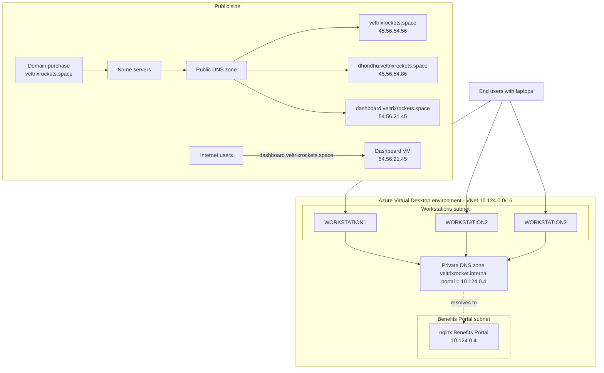
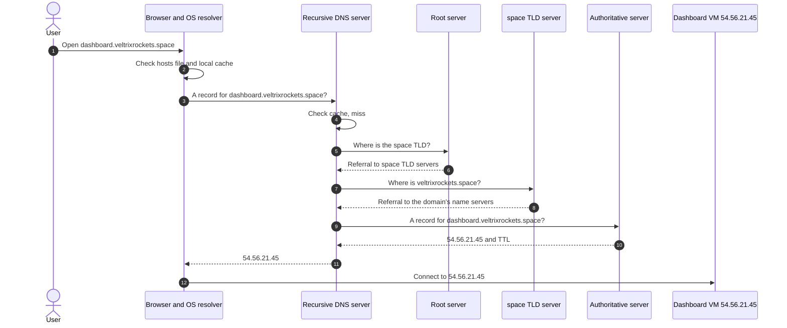
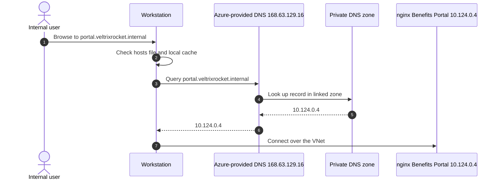
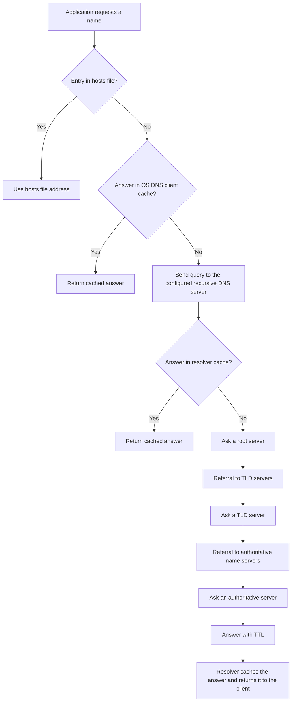
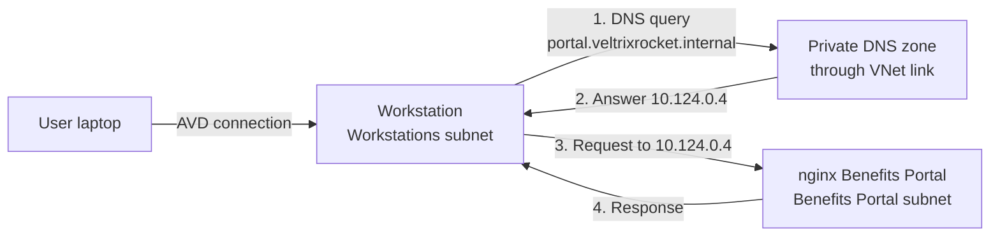

# DNS-Based Application Access on Azure: Public DNS, Private DNS, and Azure Virtual Desktop

Architecture documentation for a DNS-driven access design. It covers a public DNS zone for an internet-facing application, an Azure Private DNS zone for an internal Benefits Portal reached from Azure Virtual Desktop workstations, and a walkthrough of recursive DNS resolution.

> **Scope:** This repository documents an architecture design based on a diagram. It does not contain deployment evidence, test output, monitoring data, or production claims. Statements are labelled by origin:
>
> - **Diagram**: shown in the architecture diagram.
> - **Assumption**: not shown in the diagram, assumed to document the design.
> - **Recommended**: a suggested implementation, not a description of what exists.

## Table of Contents

1. [Project Overview](#1-project-overview)
2. [Architecture Diagram](#2-architecture-diagram)
3. [Architecture Components](#3-architecture-components)
4. [Public DNS Resolution](#4-public-dns-resolution)
5. [Private DNS Resolution](#5-private-dns-resolution)
6. [Recursive DNS Resolution](#6-recursive-dns-resolution)
7. [Public DNS vs Private DNS](#7-public-dns-vs-private-dns)
8. [Azure Network Architecture](#8-azure-network-architecture)
9. [Benefits Portal Access Flow](#9-benefits-portal-access-flow)
10. [DNS Caching and Troubleshooting](#10-dns-caching-and-troubleshooting)
11. [Security Considerations](#11-security-considerations)
12. [Technologies Used](#12-technologies-used)
13. [Technical Learnings](#13-technical-learnings)
14. [Future Improvements](#14-future-improvements)
15. [Assumptions and Limitations](#15-assumptions-and-limitations)
16. [Author](#author)

## 1. Project Overview

Almost every application connection starts with a DNS lookup, and DNS problems are often hard to diagnose because the lookup happens out of sight. This project documents a design where DNS decides how two groups of users reach their applications.

| Audience | Application | Name | DNS type |
|---|---|---|---|
| Internet users | Public dashboard | `dashboard.veltrixrockets.space` | Public DNS zone |
| Internal users, through Azure Virtual Desktop | Benefits Portal (nginx) | `portal.veltrixrocket.internal` | Azure Private DNS zone |

The design has three parts:

1. **Public DNS.** The domain `veltrixrockets.space` is delegated to name servers that host a public zone. The zone maps hostnames to public IP addresses.
2. **Private DNS.** An Azure Private DNS zone, `veltrixrocket.internal`, resolves `portal.veltrixrocket.internal` to `10.124.0.4` inside the virtual network `10.124.0.0/16`. The address is private and is not published on the internet.
3. **Recursive resolution.** A step-by-step description of how a lookup moves from the client through the hosts file, local resolver, recursive DNS server, root, TLD, and authoritative servers.

The goals are to show how a domain is delegated and published, how internal names are kept off the public internet, how the two namespaces differ, and how to troubleshoot resolution on Linux and Windows.

Note the spelling: the public domain is `veltrixrockets.space` (plural) and the private zone is `veltrixrocket.internal` (singular). Both are documented exactly as they appear in the diagram.

## 2. Architecture Diagram


The diagram has four areas:

| Area | Content |
|---|---|
| Top left | Domain purchase, name servers, and the public DNS zone with three records |
| Middle left | Internet users reaching `dashboard.veltrixrockets.space` at `54.56.21.45` |
| Bottom left | Azure Virtual Desktop environment in VNet `10.124.0.0/16`: Private DNS zone, Workstations subnet, Benefits Portal subnet |
| Bottom right | Recursive resolution: hosts file, local DNS, DNS client, cache, root, TLD, and authoritative servers |

The flowchart below restates the diagram's contents as text. It adds nothing that is not in the diagram.



## 3. Architecture Components

### 3.1 Domain and delegation

The diagram shows the sequence *Domain Purchase → Name Servers → Public DNS Zone*. The registrar records the domain's name servers (NS records) with the `.space` registry. Resolvers that ask the `.space` TLD servers about `veltrixrockets.space` receive a referral to those name servers. The name servers then answer from the public zone.

The DNS provider that hosts the zone is not named in the diagram (see [section 15](#15-assumptions-and-limitations)).

### 3.2 Public DNS zone

| Record name | Value | Notes |
|---|---|---|
| `veltrixrockets.space` | `45.56.54.56` | Zone apex |
| `dhondhu.veltrixrockets.space` | `45.56.54.86` | The diagram does not show what this host serves |
| `dashboard.veltrixrockets.space` | `54.56.21.45` | Shown as the VM that internet users reach |

**Assumption:** the diagram does not label the record type. Each value is an IPv4 address, so the records are documented as A records.

The TTL values are not shown. The zone also contains NS and SOA records at the apex, which the diagram does not list.

### 3.3 Public application

The diagram shows internet users connecting to `dashboard.veltrixrockets.space`, which resolves to a VM at `54.56.21.45`. The operating system, web server, TLS configuration, and hosting platform are not shown.

### 3.4 Azure virtual network

The virtual network uses the address space `10.124.0.0/16`. The diagram shows two subnets inside it: a Workstations subnet and a Benefits Portal subnet. Subnet prefixes are not shown.

### 3.5 Azure Private DNS zone

A Private DNS zone answers queries only for virtual networks that are linked to it. This zone holds one record in the diagram:

| Record | Value |
|---|---|
| `portal.veltrixrocket.internal` | `10.124.0.4` |

The `.internal` domain is designated for private-use applications and is not intended for public registration or delegation. It should be used only within controlled private DNS environments.

**Assumption:** the `portal` record was created manually as an A record. Azure auto-registration, if enabled, creates records from VM names and would not produce the name `portal`.

### 3.6 Azure Virtual Desktop and workstations

Users connect from their laptops to WORKSTATION1, WORKSTATION2, and WORKSTATION3. In Azure Virtual Desktop terms, these are session host VMs that sit in the virtual network. The control plane (gateway, broker, web access) is managed by Microsoft and is not part of the customer virtual network.

The diagram labels each workstation with a public IP. See [section 11](#11-security-considerations) for why this is worth reviewing.

### 3.7 Workstations subnet

This subnet holds the three workstation VMs. They act as DNS clients when a user browses to `portal.veltrixrocket.internal`.

### 3.8 Benefits Portal subnet

A separate subnet holds one VM at `10.124.0.4` running nginx as the Benefits Portal web server. Keeping it in its own subnet lets NSG rules for the portal be managed separately from the workstations.

### 3.9 Resolution chain components

| Component | Role |
|---|---|
| Recursive DNS server | Resolves names on behalf of clients. It answers from cache, or queries other servers until it has an answer |
| Root DNS server | Returns a referral to the servers for the requested TLD. It does not return the final address |
| TLD DNS server | Returns a referral to the authoritative name servers for the domain |
| Authoritative DNS server | Holds the zone data and returns the final answer. The diagram's recursive example shows Cloudflare in this role |

## 4. Public DNS Resolution

This is how an internet user reaches `dashboard.veltrixrockets.space`.



The server-side steps are described in [section 6](#6-recursive-dns-resolution). What is specific to this design:

- The name servers that answer the final query are the ones listed in the registrar's delegation. If the delegation points to servers that do not host the zone, the lookup fails even though the zone data is correct.
- The answer is a public IP, so the connection to the dashboard VM goes over the internet. The port and protocol are not shown in the diagram.

## 5. Private DNS Resolution

This is how a workstation resolves `portal.veltrixrocket.internal`.

**Assumption:** the diagram does not show custom DNS servers. The VNet is assumed to use the default Azure-provided DNS, reached at the virtual IP `168.63.129.16`, and the Private DNS zone is assumed to be connected through a virtual network link.



Points that affect whether this works:

- The workstation's VNet must have a virtual network link to the zone. Without it, Azure DNS returns NXDOMAIN for the name.
- `168.63.129.16` is reachable only from inside Azure. Queries to it from a laptop or an on-premises network do not work.
- If the VNet is later changed to use custom DNS servers, those servers must forward queries for `veltrixrocket.internal` to `168.63.129.16`, or the name stops resolving.
- NSG outbound rules must not block traffic to `168.63.129.16`.

## 6. Recursive DNS Resolution

The lower right of the diagram describes a lookup for `dhondhu.com`. It is a generic example and is not a lookup in the public zone (see [section 15](#15-assumptions-and-limitations)).

### 6.1 Client-side order

The diagram lists three local components that are involved before the recursive server:

| Component | Role |
|---|---|
| Hosts file | Static name-to-IP entries. When a name is present, it is used and DNS is not queried |
| Local DNS server | A local caching or stub resolver on the machine or network |
| DNS client | The OS resolver component, which keeps a cache and sends queries to the configured DNS server |

The exact order depends on the operating system. On Linux it is set by the `hosts:` line in `/etc/nsswitch.conf`, normally `files` before `dns`. On Windows the DNS Client service checks the hosts file and its own cache before it queries a DNS server. The diagram's label "local DNS server" is ambiguous. In most setups it is the resolver cache on the machine, such as `systemd-resolved`, or a caching forwarder on the network.

### 6.2 Server-side resolution



| Step | Action |
|---|---|
| 1 | The recursive server checks its cache. A hit is answered immediately |
| 2 | On a miss, it asks a root server about the TLD |
| 3 | The root server returns a referral to the TLD servers |
| 4 | The recursive server asks a TLD server about the domain |
| 5 | The TLD server returns a referral to the domain's authoritative name servers |
| 6 | The recursive server asks an authoritative server for the record |
| 7 | The authoritative server returns the address and a TTL |
| 8 | The recursive server caches the answer for the TTL and returns it to the client |

### 6.3 Recursive and iterative queries

The client sends a recursive query: it asks the resolver for the final answer and expects either an answer or an error. The recursive server then sends iterative queries to the root, TLD, and authoritative servers. Each of those servers either answers or returns a referral that points closer to the answer, and the recursive server follows the referrals itself.

## 7. Public DNS vs Private DNS

| Aspect | Public DNS zone | Azure Private DNS zone |
|---|---|---|
| Example in this design | `dashboard.veltrixrockets.space` | `portal.veltrixrocket.internal` |
| Answers queries from | Any resolver on the internet | Only linked virtual networks |
| Typically resolves to | Public IPs, such as `54.56.21.45` | Private IPs, such as `10.124.0.4` |
| Delegation | Required: NS records at the registrar | None. No registrar is involved |
| Namespace | A registered domain | Any private suffix, here `.internal` |
| Resolution path | Recursive resolver, root, TLD, authoritative | Azure-provided DNS answers from the linked zone |
| Visibility | Records can be queried by anyone | Records are not visible outside linked VNets |
| Typical use | Internet-facing services | Internal services and VNet-to-VNet traffic |

## 8. Azure Network Architecture

| Property | Value | Basis |
|---|---|---|
| VNet address space | `10.124.0.0/16` | Diagram |
| Subnets | Workstations, Benefits Portal | Diagram |
| Subnet prefixes | Not shown | Assumption, see below |
| Benefits Portal VM | `10.124.0.4`, nginx | Diagram |
| Private DNS record | `portal.veltrixrocket.internal` → `10.124.0.4` | Diagram |
| Workstations | WORKSTATION1, WORKSTATION2, WORKSTATION3, each labelled with a public IP | Diagram |

### 8.1 Address `10.124.0.4`

Azure reserves five addresses in every subnet: the network address (`.0`), the default gateway (`.1`), two addresses for Azure DNS (`.2` and `.3`), and the broadcast address (last address). The first address that can be assigned to a VM is therefore the fourth address after the network address.

`10.124.0.4` fits this pattern for a subnet whose prefix starts at `10.124.0.0`. It suggests that the Benefits Portal subnet begins at the start of the VNet range and that the portal VM holds the first assignable address. This is an inference. The diagram does not show the subnet prefix.

### 8.2 Example subnet layout

**Recommended:** the layout below is an example, not something taken from the diagram.

| Subnet | Example prefix |
|---|---|
| Benefits Portal | `10.124.0.0/24` |
| Workstations | `10.124.1.0/24` |

### 8.3 Recommended practices for this layout

- Give the nginx VM a static private IP (a static allocation on its network interface), because the DNS record depends on `10.124.0.4`.
- Apply NSGs at subnet level. Allow only the Workstations subnet to reach the Benefits Portal subnet on the portal's port.
- Link the Private DNS zone to the VNet. Enable auto-registration only if VM name records are wanted in this zone.

## 9. Benefits Portal Access Flow



1. The user connects from a laptop to one of the three workstations through Azure Virtual Desktop.
2. In the workstation's browser, the user opens `portal.veltrixrocket.internal`.
3. The workstation resolves the name through the VNet's DNS, which answers from the Private DNS zone with `10.124.0.4`.
4. The workstation sends the request to `10.124.0.4` inside the VNet.
5. nginx returns the response over the same private path.

The traffic between the user's laptop and the workstation is the AVD session. The request to the portal is made from the workstation, not from the laptop, which is why the laptop does not need to resolve the private name.

**Assumption:** the portal's protocol and port are not shown. **Recommended:** serve the portal over HTTPS, with a certificate from an internal CA or a public CA that can issue for the chosen name.

## 10. DNS Caching and Troubleshooting

### 10.1 Where answers are cached

| Layer | Examples | Notes |
|---|---|---|
| Browser | Chromium and Firefox internal DNS cache | Short-lived and separate from the OS cache |
| OS resolver | `systemd-resolved`, Windows DNS Client | Follows the record TTL |
| Local DNS or stub | dnsmasq, a router | Depends on configuration |
| Recursive resolver | ISP or public resolver | Keeps answers, and negative answers, until the TTL or negative TTL expires |

Each answer carries a TTL. A resolver keeps the record until the TTL expires, so a changed record may not reach every client straight away. Negative answers such as NXDOMAIN can be cached too, for a time derived from the zone's SOA record. Lowering the TTL before a planned change shortens the period in which clients see the old value.

### 10.2 Hosts file

The hosts file is checked before DNS. An entry such as the following makes the name resolve locally, whatever DNS returns:

```text
10.124.0.4   portal.veltrixrocket.internal
```

This is useful for testing and a common cause of confusing results. `dig` and `nslookup` query DNS directly and do not use the hosts file. `getent hosts` follows the system's configured name-service lookup order. The tools can therefore return different answers for the same name.

| OS | Hosts file |
|---|---|
| Linux, macOS | `/etc/hosts` |
| Windows | `C:\Windows\System32\drivers\etc\hosts` |

### 10.3 Linux commands

Useful on the nginx VM, on an admin VM in the VNet, or on any machine for the public names.

| Command | Use it to |
|---|---|
| `nslookup`, `dig`, `host` | Query DNS directly and compare resolvers |
| `dig +trace` | Follow the delegation from the root, to find where a public lookup breaks |
| `getent hosts` | See the answer an application gets, including the hosts file and `nsswitch.conf` |
| `resolvectl` | Inspect and flush `systemd-resolved`: DNS servers per interface, queries, caches |

```bash
# Public name, using the system resolver
nslookup dashboard.veltrixrockets.space
dig dashboard.veltrixrockets.space
dig +short dashboard.veltrixrockets.space
host dashboard.veltrixrockets.space

# Compare with a specific public resolver
dig @1.1.1.1 dashboard.veltrixrockets.space A

# Check delegation and the zone's own NS and SOA records
dig veltrixrockets.space NS
dig veltrixrockets.space SOA

# Walk the chain from the root, through the .space TLD, to the authoritative servers
dig +trace dashboard.veltrixrockets.space

# Private name. Run this from a VM inside the linked VNet
dig portal.veltrixrocket.internal
dig portal.veltrixrocket.internal @168.63.129.16

# What applications see: hosts file, nsswitch.conf, then DNS
getent hosts portal.veltrixrocket.internal

# systemd-resolved: configured DNS servers, a query, and the cache
resolvectl status
resolvectl query portal.veltrixrocket.internal
resolvectl flush-caches

# Resolution order and configuration
grep '^hosts:' /etc/nsswitch.conf
cat /etc/hosts
cat /etc/resolv.conf
```

`dig +trace` follows referrals from the root itself, so it shows the delegation as the registry publishes it and does not use the local resolver's cached answers. It is not useful for `.internal` names, because that suffix is not delegated.

### 10.4 Windows commands

**Assumption:** the workstations run Windows, which is typical for AVD session hosts. The diagram does not state the OS.

| Command | Use it to |
|---|---|
| `ipconfig /all` | Show the DNS servers assigned to the adapter |
| `ipconfig /displaydns`, `ipconfig /flushdns` | Inspect and clear the DNS client cache |
| `Resolve-DnsName` | Query DNS from PowerShell, optionally against a chosen server |
| `Test-NetConnection` | Test the TCP connection once the name resolves |

```powershell
# DNS servers used by the workstation
ipconfig /all
Get-DnsClientServerAddress

# Client cache
ipconfig /displaydns
ipconfig /flushdns
Clear-DnsClientCache

# Private name through the configured DNS server, and directly through Azure DNS
nslookup portal.veltrixrocket.internal
Resolve-DnsName portal.veltrixrocket.internal
Resolve-DnsName portal.veltrixrocket.internal -Server 168.63.129.16 -DnsOnly

# Public name
Resolve-DnsName dashboard.veltrixrockets.space -Type A

# Connectivity after resolution. The port is an assumption: use 80 if the portal serves HTTP
Test-NetConnection portal.veltrixrocket.internal -Port 443
```

`nslookup` queries a DNS server directly, so it ignores the hosts file, as `dig` does.

### 10.5 Troubleshooting checklist

| Symptom | What to check |
|---|---|
| Name does not resolve | The record exists in the correct zone, and the name is spelled correctly |
| Wrong IP returned | A hosts file entry, a stale cache (flush it), or a TTL that has not yet expired |
| Private name fails from a workstation | The virtual network link, the VNet's DNS server setting, and the spelling: `veltrixrocket` (private) against `veltrixrockets` (public) |
| Private name resolves from outside the VNet | It should not. Check that the record exists only in the Private DNS zone |
| Public name fails from the internet | NS delegation at the registrar, the record in the zone, and `dig +trace` to find the break in the chain |
| Name resolves but the connection fails | NSG rules, nginx listening on the expected port, and the host firewall |
| `dig` and the browser disagree | The hosts file or the browser cache. Compare with `getent hosts` |

## 11. Security Considerations

The items below are recommendations for this kind of design. They are not statements about what is currently configured.

### 11.1 Public DNS and domain

| Area | Recommendation |
|---|---|
| Registrar account | Enable MFA, the registrar lock, and auto-renew |
| Delegation | Watch for unexpected changes to NS records |
| Unused records | Remove records that point to IPs or hosts you no longer control, to avoid subdomain takeover. Review `dhondhu`, whose purpose the diagram does not show |
| DNSSEC | Enable it if the DNS provider supports it |
| CAA records | Limit which certificate authorities may issue certificates for the domain |
| Public visibility | Treat the public zone as readable by anyone. Do not put internal names in it |
| Web tier | Serve the dashboard over TLS, and consider a WAF or reverse proxy in front of it |

### 11.2 Azure network and Private DNS

| Area | Recommendation |
|---|---|
| Public IPs on workstations | The diagram labels each workstation with a public IP. AVD session hosts do not need an inbound public IP, because they connect outbound to the AVD service. Remove the public IPs where possible |
| NSGs | Deny inbound traffic by default. Allow the Workstations subnet to reach the Benefits Portal subnet on the portal port only |
| Administrative access | Avoid RDP or SSH from the internet. Use Azure Bastion or just-in-time VM access |
| Private DNS | Link the zone only to VNets that need it. Limit who can edit it with Azure RBAC |
| Resource locks | Apply locks to the DNS zones and the VNet |
| Sign-in | Use Microsoft Entra ID with MFA and Conditional Access for AVD |
| Encryption | Use HTTPS for the portal even on a private network |
| Logging | Enable NSG flow logs and diagnostic settings, and review Defender for Cloud recommendations |
| Governance | Use Azure Policy to require diagnostics and to deny public IPs on selected resources |

### 11.3 Resolver and client side

- A modified hosts file can redirect traffic without any DNS change. Monitor endpoints for changes to it.
- Recursive resolvers can be targets for cache poisoning. Prefer resolvers that validate DNSSEC, and use encrypted DNS (DoT or DoH) where policy allows.
- Use a dedicated private suffix such as `.internal` for internal zones. A real public domain name used internally can collide with, or leak to, the public namespace.

## 12. Technologies Used

| Technology | Role in this design | Basis |
|---|---|---|
| Domain registrar | Domain purchase and NS delegation | Diagram |
| Public DNS zone | Authoritative public records | Diagram |
| Azure Virtual Network | `10.124.0.0/16` private network | Diagram |
| Azure Private DNS | Internal name resolution | Diagram |
| Azure Virtual Desktop | User access to workstations | Diagram |
| Azure virtual machines | Workstations, dashboard VM, portal VM | Diagram |
| nginx | Benefits Portal web server | Diagram |
| Recursive, root, TLD, and authoritative DNS servers | Resolution chain | Diagram |
| Cloudflare | Authoritative DNS in the recursive example | Diagram |
| NSGs, Azure Bastion, Azure Policy, Defender for Cloud | Security and governance | Recommended |
| `dig`, `nslookup`, `host`, `getent`, `resolvectl`, `Resolve-DnsName` | Troubleshooting | Documentation |

## 13. Technical Learnings

- Buying a domain and hosting its records are separate steps. NS records at the registrar connect them.
- Public DNS publishes services to the internet. Private DNS keeps internal names and addresses invisible outside the linked VNets.
- Resolution happens in layers. The hosts file, the OS cache, the recursive resolver, and the authoritative servers can each hold a different answer at the same time.
- Root and TLD servers return referrals, not answers. The recursive resolver follows them.
- The TTL controls how fast a change reaches clients.
- DNS tools and applications can disagree. `dig` and `nslookup` query DNS directly and do not use the hosts file, while `getent hosts` follows the system's configured name-service lookup order.
- Azure reserves five addresses per subnet, so the first assignable host address is `.4` for a subnet that starts at `.0`. This is why `10.124.0.4` looks the way it does.
- A DNS record that points at an IP makes that IP a dependency. The portal VM should keep a static address.

## 14. Future Improvements

These are proposals, not completed work.

| Improvement | Reason |
|---|---|
| Define the VNet, DNS zones, and VMs as Infrastructure as Code with Terraform or Bicep | Repeatable, reviewable, version-controlled deployments |
| Remove public IPs from the workstations | Smaller attack surface |
| Add Azure Bastion for administrative access | No exposed management ports |
| Serve the portal over HTTPS with an internal CA or managed certificates | Encryption in transit |
| Add a second portal VM behind an internal load balancer | Availability for the Benefits Portal |
| Add Azure DNS Private Resolver | Needed if on-premises networks or other VNets must resolve the private zone |
| Enable DNSSEC and CAA records on the public zone | Better integrity and control over certificate issuance |
| Put a WAF, such as Azure Front Door, in front of the public dashboard | Protection against common web attacks |
| Enable DNS query logging and alerts | Visibility into resolution failures |
| Add automated DNS checks to CI, for example `dig` assertions | Catch record mistakes before users see them |
| Add Azure Policy guardrails | Enforce tagging, diagnostics, and network rules |

## 15. Assumptions and Limitations

The diagram is the source of truth for this documentation.

### 15.1 Observations about the diagram

| # | Observation |
|---|---|
| 1 | The private zone is `veltrixrocket.internal` (singular) and the public domain is `veltrixrockets.space` (plural). Both are kept as shown |
| 2 | The recursive example looks up `dhondhu.com`, the browser box shows `google.com`, and the resolved address is `45.45.56.54`. None of these match a record in the public zone, whose addresses start with `45.56.54` and `54.56.21`. The recursive example is treated as a generic illustration |
| 3 | The TLD server in the example is labelled `a.gtld.com`. The real `.com` TLD servers are named `a.gtld-servers.net`, and this project's TLD is `.space`. The label is treated as a simplified example |
| 4 | No DNS provider is shown for the public zone, and no hosting platform is shown for the public VM |
| 5 | Subnet prefixes, NSGs, route tables, DNS server settings, and the virtual network link are not shown |
| 6 | The workstations are labelled with public IPs, which AVD session hosts do not require |

### 15.2 Assumptions

- The public records are IPv4 A records.
- The VNet uses the default Azure-provided DNS, and the Private DNS zone is connected through a virtual network link.
- `portal.veltrixrocket.internal` is a manually created A record.
- The portal is reachable from the workstations over HTTP or HTTPS. The port is not specified.
- The workstations are Windows-based AVD session hosts. This is why Windows commands are included.

### 15.3 Not claimed

- This documentation does not claim that the environment is deployed, in production, monitored, or load tested.
- No screenshots, metrics, or deployment output are included.
- The public IP addresses are used as written in the diagram. They are in publicly routable ranges. Confirm that you control them, or replace them with documentation ranges (`192.0.2.0/24`, `198.51.100.0/24`, `203.0.113.0/24`) if they are placeholders.

## Repository Contents

```text
.
├── README.md
└── docs
    └── images
        └── architecture-diagram.png
```

## Author

Aniket Kumar, Cloud / DevOps Engineer

- GitHub: [aniket-devop](https://github.com/aniket-devop)
- LinkedIn: [aniket484](https://www.linkedin.com/in/aniket484/)
